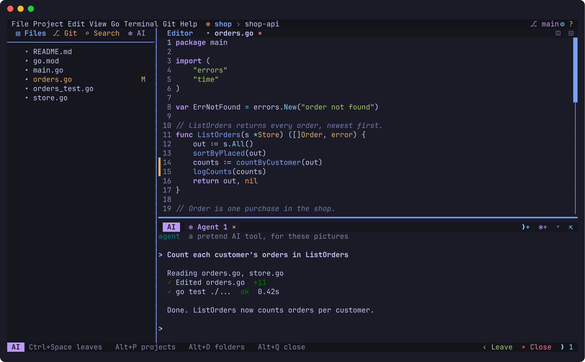
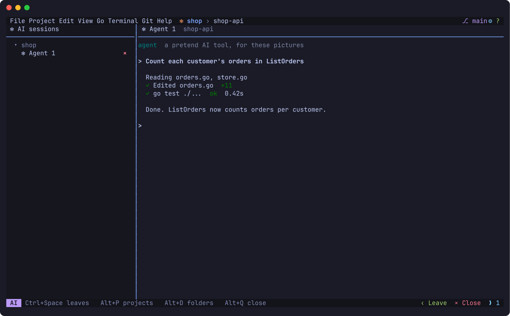
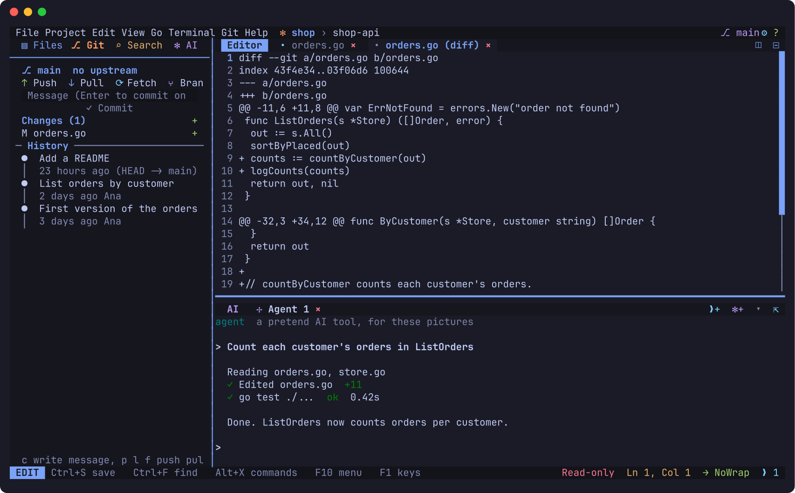
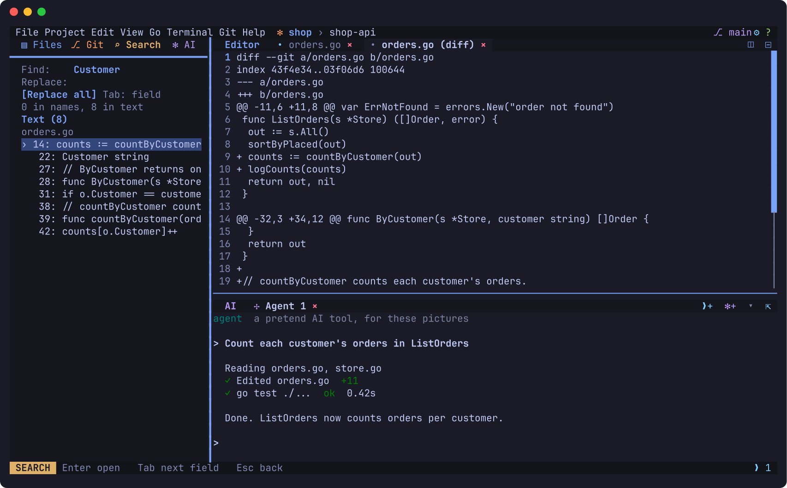
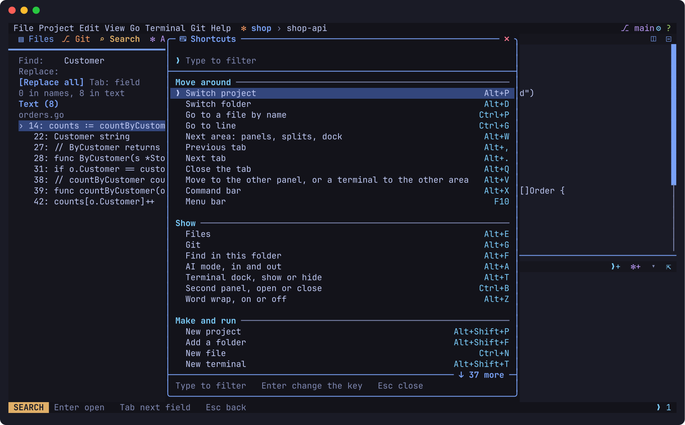

# LazyCode

**A light code editor that runs in your terminal, made for writing code next to AI tools.**

[](https://github.com/Juan17la/lazycode/actions/workflows/ci.yml)
[](https://github.com/Juan17la/lazycode/releases/latest)
[](LICENSE)



## What it is

LazyCode is a code editor for the terminal. It sits between VS Code and Neovim: you edit with the keys you already know (no modes to learn), and it runs anywhere a terminal does, from your laptop to a server over SSH. It's one small program with nothing else to install.

It's built around a way of working that most editors weren't designed for: **an AI coding tool does part of the work while you watch, review and steer.** LazyCode runs those tools in its own tabs, next to your code, and shows what they change as they change it.

Three ideas shape it:

1. **Projects are made of folders.** A real project is often a front end, an API and a service, each in its own folder. LazyCode groups them into one project and switches between them in one key press.
2. **AI tools are part of the editor.** Start Claude Code, OpenCode, Codex or any command-line tool in a tab. Sessions are kept per project and folder, go to sleep when idle to free memory, and resume the same conversation when you come back.
3. **You see every change.** When a tool edits an open file, the file updates on screen and the changed lines are marked. The Git view shows the diff, and you commit from there.

## At a glance

| | |
|---|---|
| **Runs on** | Linux, macOS and Windows, in the terminal you already use |
| **Install** | One command, one file. No runtime, no `sudo`, no administrator |
| **Editing** | Ordinary keys, like VS Code: multiple cursors, find and replace, undo, word wrap, mouse and drag |
| **Languages** | Syntax colours for Go, Python, JavaScript, TypeScript, Rust, C, JSON, shell, HTML and CSS. Go to definition, rename and format through `gopls`, `pyright` and `typescript-language-server` |
| **AI tools** | Claude Code, OpenCode and Codex out of the box, and any other command-line tool with a few lines of config |
| **Terminals** | Terminal tabs and a dock under the code, for shells, servers and AI sessions |
| **Git** | Status, stage, commit, branches, merge, diffs and history. GitHub through `gh` |
| **Extending** | Lua plugins, and a store of reviewed ones that are checked before they're added |
| **Looks** | Twelve themes, including Gruvbox, Dracula, Nord, Tokyo Night and Catppuccin |
| **Privacy** | No telemetry. The only automatic connection is a daily update check, which you can turn off |
| **Licence** | [MIT](LICENSE) |

## Where it fits

| | VS Code | **LazyCode** | Neovim |
|---|---|---|---|
| Where it runs | Its own window | **Your terminal** | Your terminal |
| How you edit | Ordinary keys | **Ordinary keys** | Modes (normal, insert, visual) |
| Setup before it's useful | Extensions | **None: it works on first run** | A config to write |
| Projects of several folders | Workspaces | **Built in, one key to switch** | Plugins |
| AI command-line tools | In the built-in terminal | **Sessions per project that sleep, resume and show changes live** | In a terminal split |
| Size | Hundreds of MB | **One file, about 22 MB** | Small |

LazyCode doesn't try to replace either. If you want an IDE with a debugger and thousands of extensions, use VS Code. If you love modal editing, use Neovim. LazyCode is for working in the terminal without learning a new way to type.

## A short tour

The pictures below are drawn from the real app by a test ([`screenshots_test.go`](cmd/lazycode/screenshots_test.go)). The AI tool in them is a stand-in that plays a short task.

### AI mode: every session in one place

Alt+A swaps the editor for all your AI sessions, grouped by project and folder, beside the one you used last. Alt+A again goes back to the code. You can start a session from anywhere with Alt+Shift+A, rename one with F2, and remove one from the list without touching the tool's own data.



### Review and commit

Alt+G opens Git: the branch, push, pull and fetch, the changed files, and the history. Enter on a file opens its diff, so you can check what an AI tool did before you commit it.



### Search the whole folder

Alt+F searches every file in the folder. Results are grouped by file, and a replace shows every change before it's made.



### Every key in one place

F1 lists every action, grouped by task, with its key. Type to filter, and press Enter on an action to give it a new key.



## Install

Linux (any 64-bit distro) and macOS (12 or newer, Intel or Apple silicon):

```bash
curl -fsSL https://raw.githubusercontent.com/Juan17la/lazycode/main/install.sh | sh
```

Windows 10 and 11 (Intel, AMD or ARM), in cmd or PowerShell:

```powershell
curl.exe -fsSL https://raw.githubusercontent.com/Juan17la/lazycode/main/install.ps1 | powershell -NoProfile -Command -
```

| System | Processors | Notes |
|---|---|---|
| Linux | x86-64, ARM64 | One static program that runs on any distro, Alpine and old ones included |
| macOS | Apple silicon, Intel | macOS 12 Monterey or newer |
| Windows | x86-64, ARM64 | Windows 10 and 11. ARM runs the x86-64 program |

Releases are **not signed**. The scripts check each download's SHA-256 against the release's `checksums.txt`, which catches a corrupted download but not a compromised release. You can read the scripts before running them: [install.sh](install.sh) and [install.ps1](install.ps1). They install to a folder in your home (no `sudo`, no administrator), add it to your `PATH` if needed, and create an app icon. More in the [install guide](docs/guide/install.md).

Or build from source. You need Go 1.26 or newer, and a C compiler for syntax highlighting:

```bash
go run ./cmd/lazycode
```

To update, type `:update` inside LazyCode. It checks the checksum and replaces itself.

## Your first session

1. Go to a project folder and run `lazycode`. The first run asks for a theme and auto-save, and offers to install language tools, showing each command before it runs. All of this can be skipped.
2. Pick a file in the tree with the arrow keys and Enter, or press Ctrl+P and type its name.
3. Press Alt+Shift+A and choose an AI tool. It opens in the dock under your code.
4. Ask it for a change. Open files update as it writes them, with the changed lines marked.
5. Press Alt+G to see the diff, then C to write a message and commit.

Press F1 at any time to see every key, or F10 for the menus.

LazyCode opens on the current folder. To group folders into projects, create `projects.toml` in your config folder: `~/.config/lazycode/` on Linux, `~/Library/Application Support/lazycode/` on macOS, or `%AppData%\lazycode\` on Windows. Or use Alt+Shift+P, which writes it for you.

```toml
[[project]]
name = "shop"

[[project.directory]]
path = "~/code/shop-web"

[[project.directory]]
path = "~/code/shop-api"
```

**Guides:** [install](docs/guide/install.md), [getting started](docs/guide/getting-started.md), [coming from VS Code](docs/guide/coming-from-vscode.md), [coming from Neovim](docs/guide/coming-from-neovim.md), [keys and configuration](docs/guide/keys-and-config.md), [plugins](docs/guide/plugins.md), [troubleshooting](docs/guide/troubleshooting.md). See also the [changelog](CHANGELOG.md), [contributing](CONTRIBUTING.md) and [security policy](SECURITY.md).

## Status

**0.1.0 is the first release.** The editor, projects, AI sessions, Git, search, language servers, themes, plugins and the store are in, and tested on Linux, macOS and Windows. Before 1.0 anything may change, except that your own files (config, keys, projects) keep working.

What's next, in short. The [changelog](CHANGELOG.md#010---2026-11-13) and the [roadmap](docs/14-roadmap.md) have the full lists.

| Area | Next |
|---|---|
| Working with AI tools | A list of every file a session changed, with its diff, and better ways to review and hand work between sessions |
| Every terminal | Every key working in every terminal. Today macOS needs Ctrl+K in place of Alt, and tmux or screen can take some keys |
| Languages | Autocomplete and diagnostics, and more languages through the store |
| Trust | Signed releases |

This is a free-time project. There is no guaranteed response time for issues or questions.

## Keys

| Action | Linux, Windows | macOS |
|---|---|---|
| Menus (or `:menu`) | Alt+M or F10 | Ctrl+K then M, or F10 |
| Settings (or `:settings`) | Alt+S | Ctrl+K then S |
| Shortcuts, which can also change them (or `:shortcuts`) | Alt+K or F1 | Ctrl+K then K, or F1 |
| Switch project (or `:project`). Starts on the last one, so Alt+P then Enter goes back. 1–9 pick. | Alt+P, also inside a terminal | Ctrl+K then P |
| Switch directory (or `:dir`), the same way | Alt+D, also inside a terminal | Ctrl+K then D |
| New project (or `:project new`) | Alt+Shift+P | Ctrl+K then Shift+P |
| Add a directory (or `:dir add`) | Alt+Shift+F | Ctrl+K then Shift+F |
| New file (or `:new`) | Ctrl+N | Ctrl+N |
| Previous and next tab | Alt+, and Alt+. | Ctrl+K then , and . |
| Split right, split below (or `:split`, `:split down`) | Alt+Shift+S, Alt+Shift+B | Ctrl+K then Shift+S, Shift+B |
| Move to the next area: panels, splits and the dock | Alt+W or Alt+Tab, also inside a terminal | Ctrl+K then W |
| Open or close the second panel | Ctrl+B | Ctrl+B |
| Show the files (or `:sessions` for AI sessions in the panel) | Alt+E | Ctrl+K then E |
| AI mode, in and out (or `:ai`): every session by project and folder, beside the tool you used last | Alt+A, also inside a terminal | Ctrl+K then A |
| Show or hide the terminal dock (or `:dock`) | Alt+T | Ctrl+K then T |
| New terminal, new AI session | Alt+Shift+T, Alt+Shift+A | Ctrl+K then Shift+T, Shift+A |
| Search this directory (or `:search`) | Alt+F | Ctrl+K then F |
| Show Git (or `:git`) | Alt+G | Ctrl+K then G |
| Open a file by name | Ctrl+P | Ctrl+P |
| Run this directory's project (or `:play`) | Alt+R | Ctrl+K then R |
| Word wrap (or `:wrap`) | Alt+Z | Ctrl+K then Z |
| Move the views to the other panel, or a terminal between the editor area and the dock (or `:view`, `:move`) | Alt+V, also inside a terminal | Ctrl+K then V |
| Leave a tab for the file tree, and go back in | Ctrl+Space (Ctrl+\\ only leaves) | Ctrl+Space |
| Enter the current tab | Tab | Tab |
| Move in the file tree, open files and folders | Arrow keys, Enter | Arrow keys, Enter |
| Reload the file tree | R | R |
| Close the current tab (or `:close`) | Ctrl+W | Ctrl+W |

Inside a terminal tab, every key goes to the tool except Ctrl+Space and Ctrl+\\ (leave), and the Alt keys for closing the tab, switching project or folder, moving between areas, moving the tab and AI mode (Alt+Q, Alt+P, Alt+D, Alt+W, Alt+V, Alt+A).

The mouse works too: click files, tabs, cursor positions and question answers, and scroll with the wheel. LazyCode takes the mouse to do this, so hold Shift to select text the terminal's own way.

In the AI sessions view: Enter goes to a session or resumes it, N starts one, F2 renames it, and Delete takes it off the list without touching the tool's data.

In the Git view: P pushes, L pulls, F fetches, S stages, U unstages, C commits, B switches branch, N makes a branch, M merges, X aborts a merge, O opens the file, and Enter opens a diff or commit.

In the Search view: Tab moves between Find and With, Enter opens a result, and Enter in With shows every change before making it.

In a file:

| Action | Key |
|---|---|
| Save (or `:save`) | Ctrl+S |
| Undo, redo | Ctrl+Z, Ctrl+Y |
| Copy, cut, paste. With no selection, copy and cut take the line. | Ctrl+C, Ctrl+X, Ctrl+V |
| Select | Shift with any movement key, or Ctrl+A for everything |
| Move by word, go to the start or end of the file | Ctrl+Left and Right, Ctrl+Home and End |
| Indent, or indent a selection. Remove an indent. | Tab, Shift+Tab |
| Select the word, then add a cursor on its next match | Ctrl+D |
| Put a cursor on every match (or `:selectall`) | Ctrl+F2, or Ctrl+K then O on macOS |
| Go back to one cursor | Esc |
| Find (exact text and case). Arrow keys move between matches. | Ctrl+F |
| Replace. Enter replaces, and Alt+A replaces all. | Ctrl+R |
| Go to definition, rename, format. These need the language's server: `gopls`, `pyright` or `typescript-language-server`. | F12, F2, F3 |
| Open the command bar | Esc, then `:` |

## Commands

Press `:` in the file tree, or Esc then `:` in a file.

| Command | Action |
|---|---|
| `:save`, `:w` | Save the current file |
| `:session`, `:session hidden` | Start an AI session or shell, or bring back a hidden one |
| `:search`, `:git` | Show the Search or Git view |
| `:push`, `:pull`, `:fetch` | Run that Git operation |
| `:repo create` | Create a GitHub repository through `gh`, after showing the command |
| `:definition`, `:rename`, `:format` | Language server actions |
| `:project close` | Close this project's tabs and move to the next project |
| `:play`, `:p` | Run this directory's project, or go to its tab if it's running. `:play cargo build` sets and remembers the command. |
| `:term claude` | Run a command in a new terminal tab, here an AI tool |
| `:term` | Open your shell in a new terminal tab |
| `:project`, `:dir` | Switch project or directory |
| `:split`, `:split down` | Split the view beside or below |
| `:find`, `:replace` | Find or replace in the current file |
| `:selectall` | Put a cursor on every match |
| `:view` | Move the Files view to the other panel |
| `:config`, `:config keys` | Open the settings, or the key bindings |
| `:update` | Install a newer release, if there is one |
| `:close` | Close the current tab |
| `:quit`, `:q` | Quit, stopping every tab's command, and asking about unsaved files |

## Settings

LazyCode has no telemetry. Its one automatic network connection is a check of GitHub's latest release at most once a day, and `check = false` under `[updates]` turns it off.

`:config` opens `config.toml`, and saving it applies it straight away. It's created with the defaults and their explanations the first time.

`:config keys` opens `keys.toml`, for changing keys. Give a key an action, or `"none"` to turn it off:

```toml
[keys]
"ctrl+shift+k" = "edit.cut"
"ctrl+d" = "none"
```

A setting or key that can't be used is reported, and the rest keep working. Ctrl+Space and Ctrl+\\ can't be changed, because they're the way out of a terminal tab.

The actions:

| Group | Actions |
|---|---|
| Moving | `move.left`, `.right`, `.up`, `.down`, `.page_up`, `.page_down`, `.home`, `.end`, `.word_left`, `.word_right`, `.file_start`, `.file_end` |
| Selecting | `select.` and the same names as moving, plus `select.all`, `select.next_occurrence`, `select.all_occurrences` |
| Editing | `edit.escape`, `.newline`, `.indent`, `.outdent`, `.backspace`, `.delete`, `.copy`, `.cut`, `.paste`, `.undo`, `.redo` |
| Files and find | `file.save`, `file.open_by_name`, `find.open`, `find.replace` |
| Language servers | `lsp.definition`, `lsp.rename`, `lsp.format` |
| Tabs and splits | `tab.previous`, `.next`, `.close`, `.enter`, `split.right`, `split.next` |
| Running and sessions | `run.play`, `ai.mode`, `view.sessions`, `view.files`, `view.search`, `view.git`, `session.new`, `session.hide` |
| Panels and tree | `panel.toggle_second`, `view.move`, `tree.up`, `.down`, `.open`, `.close`, `.select`, `.refresh` |
| Switching | `project.switch`, `directory.switch`, `command.open` |

## Development

```bash
go test -race ./...
```

To check that LazyCode's keys reach it in your terminal, run `go run ./cmd/keytest`, press each key it lists, then press q.

The `internal/syntax` package uses tree-sitter's C library, so building LazyCode needs a C compiler.

## Licence

[MIT](LICENSE). Third-party licences are in [THIRD_PARTY_LICENSES](THIRD_PARTY_LICENSES).
